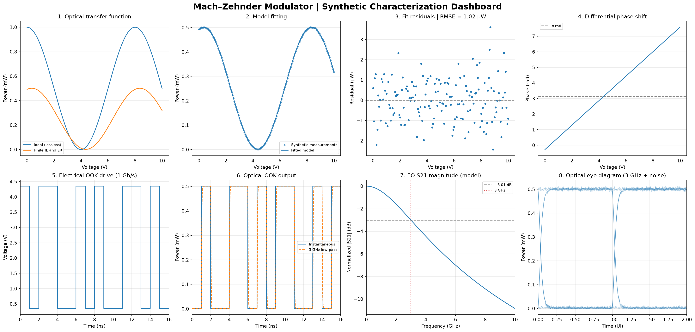

# Mach–Zehnder Modulator Characterization Using Python

## Project Overview

This project presents a Python-based numerical characterization of a Mach–Zehnder optical modulator (MZM), focusing on its DC optical transmission, electro-optic response, and digital modulation performance.

The objective is to demonstrate photonic integrated circuit (PIC) characterization techniques relevant to optical communication and silicon photonics testing.

## Characterization Features

- Optical transmission versus applied voltage
- Half-wave voltage (Vπ) extraction
- Extinction ratio and insertion loss analysis
- Nonlinear model fitting and residual analysis
- Differential optical phase shift
- On-off keying (OOK) modulation
- Electro-optic S21 frequency response
- Optical eye diagram with simulated noise

## Simulation Parameters

| Parameter | Value |
|---|---|
| Operating wavelength | 1550 nm |
| Input optical power | 1 mW |
| Half-wave voltage | 4 V |
| Insertion loss | 3 dB |
| Extinction ratio | 25 dB |
| EO 3 dB bandwidth | 3 GHz |
| Digital modulation rate | 1 Gb/s |

## Characterization Dashboard

The dashboard contains eight plots illustrating the simulated optical and electro-optic characteristics of the modulator.

## Key Results

- Extracted half-wave voltage: approximately 4 V
- Insertion loss: approximately 3 dB
- Extinction ratio: approximately 25 dB
- Model fitting RMSE: approximately 1.02 µW
- Modeled electro-optic bandwidth: 3 GHz
- Open optical eye diagram at 1 Gb/s under the assumed model conditions

## Tools and Technologies

Python, NumPy, SciPy, Matplotlib, integrated photonics, electro-optic modulation, and optical communication systems.

## Running the Simulation

Install dependencies:

`python -m pip install -r requirements.txt`

Run the program:

`python mzm_characterization.py`

## Limitations

This project uses synthetic measurement data and simplified mathematical models. The results are not based on experimental device characterization. The electro-optic frequency response uses an assumed bandwidth-limited model rather than a full traveling-wave electrode simulation.

## Author

**Mahmudul Hassan Sourav**

M.Sc. Optoelectronics and Photonics

Paderborn University, Germany
